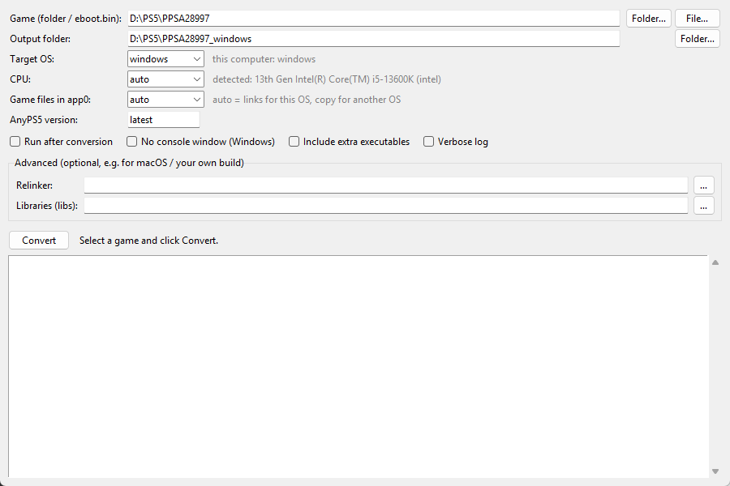

# AnyPS5 Converter

One-click front end for [AnyPS5](https://github.com/boykopovar/AnyPS5): point it at a PS5 game dump and get a native Windows, Linux or macOS program.



AnyPS5 is not an emulator. Its relinker rewrites a PS5 executable into a native program that runs against reimplemented system libraries. Converting a game by hand takes several steps: unwrap every SELF container, find the module folders, pick the right relinker flags for your CPU, download the matching libraries and lay out `libs/` and `app0/`. This tool does all of that for you.

## Features

- **GUI and command line**: a single Python file, standard library only.
- **Cross-platform**: runs on Windows, Linux and macOS, and builds for Windows, Linux or macOS targets.
- **CPU selection**: detects your CPU and picks the right mode:
  - AMD: native, no flags.
  - Intel: `--to-intel`.
  - Apple Silicon: `--to-rosetta`.
  - You can override the detected mode.
- **Automatic SELF unwrapping**: `eboot.bin`, `sce_module/`, Unity `Media/Plugins` and `Media/Modules`, and any other folder with modules. Encrypted files are detected and reported.
- **Automatic downloads**: fetches the relinker and system libraries from the AnyPS5 GitHub release (latest or a chosen version) and caches them.
- **No 25 GB copies**: on the same OS, `app0/` is built from hard links and junctions/symlinks to the original files. Choose copy mode to move the game to another machine or OS.
- **Safe rebuilds**: converting again into the same folder rebuilds the program and keeps save data (`_sd`, `data`) and the shader cache.

## Requirements

- Python 3.8+ (on Linux the GUI needs `python3-tk`)
- A **decrypted** PS5 game dump: the folder with `eboot.bin`, `sce_sys/`, `sce_module/`, …
- To run the converted game: an x86-64 CPU with AVX2, FMA, F16C, BMI1/2, LZCNT and MOVBE, and a Vulkan GPU.

## Usage

### GUI

- **Windows**: double-click `AnyPS5-Converter.bat`.
- **Linux/macOS**: run `./anyps5-converter.sh`.

Select the game folder (or `eboot.bin`), adjust the options if needed and click **Convert**.

### Command line

```sh
python anyps5_converter.py <game folder | eboot.bin> [options]
```

| Option | Description |
|---|---|
| `-o, --output DIR` | Output folder (default `<game folder>_<os>`) |
| `--os windows\|linux\|macos` | Target OS (default: this computer) |
| `--cpu auto\|amd\|intel\|rosetta` | Target CPU: `amd` keeps the code as is, `intel` adds `--to-intel`, `rosetta` is for Apple Silicon (macOS only) |
| `--version vX.Y.Z` | AnyPS5 release (default: latest) |
| `--link-mode auto\|link\|copy` | Game files in `app0/`: links (no extra disk space) or a full copy. `auto` links when the target OS is this OS and copies otherwise |
| `--run` | Launch the game after conversion |
| `--windows-gui` | Windows program without a console window (output goes to `anyps5.log`) |
| `--include-executables`, `--executable PATH` | Extra game executables started with `sceSystemServiceLoadExec` |
| `--relinker FILE`, `--libs DIR` | Custom relinker / libraries (required for macOS, see below) |
| `--extra ARG` | Extra argument passed to the relinker (repeatable) |
| `--force`, `--keep-stage`, `-v` | Write into a non-empty folder, keep the unwrapped ELF files, verbose log |

Examples:

```sh
python anyps5_converter.py D:\PS5\PPSA12345                        # Windows build for this PC
python anyps5_converter.py D:\PS5\PPSA12345 --os linux -o E:\game  # Linux build (files copied)
python anyps5_converter.py ~/games/PPSA12345 --cpu amd --run
```

## Output layout

```text
<output>/
  Game.exe | Game.elf | Game   converted program
  libs/                         AnyPS5 system libraries
  app0/                         game files + converted modules (*.guest.prx)
```

Start the program from its folder. On Linux, if you get a `/dev/udmabuf` error, add your user to the `kvm` group.

## How it works

1. Finds `eboot.bin` and every folder with `.prx`/`.sprx` modules. `sce_sys/` and `fakelib/` are skipped because AnyPS5 provides those libraries.
2. Unwraps SELF/fSELF containers into clean ELF files with [`unwrap_self.py`](unwrap_self.py) from AnyPS5.
3. Downloads `relinker` and `prx-<os>` for the chosen release into `cache/`.
4. Builds `app0/`, then runs the relinker with `--windows`/`--macos`, `--to-intel`/`--to-rosetta` and one `--module-dir` per module folder.
5. Copies `libs/` and writes `.anyps5-converter.json`, which later rebuilds use.

## Limitations

- **Encrypted dumps are refused.** Games must be dumped and decrypted on a console; this tool does not decrypt anything.
- **macOS needs your own build.** AnyPS5 releases ship the relinker and libraries for Windows and Linux only. On macOS, or for a macOS target, build them from source ([BUILD.md](https://github.com/boykopovar/AnyPS5/blob/main/docs/dev/BUILD.md)) and set `--relinker` / `--libs`.
- **Game compatibility depends on AnyPS5.** See the [AnyPS5 compatibility map](https://alxcbtw.github.io/anyps5-roadmap/).
- **Linked files are the originals.** In link mode the files in `app0/` are the original game files: do not delete the source folder, and do not edit the files in `app0/`.

## Credits and license

All the hard work is done by [AnyPS5](https://github.com/boykopovar/AnyPS5) by boykopovar and contributors. This is an unofficial helper.

Licensed under GPL-2.0 (see [LICENSE](LICENSE)), the same license as AnyPS5. `unwrap_self.py` is copied from AnyPS5 commit `f474fb7`.

This tool does not include or download any game content, firmware or keys. Only use games you own.
